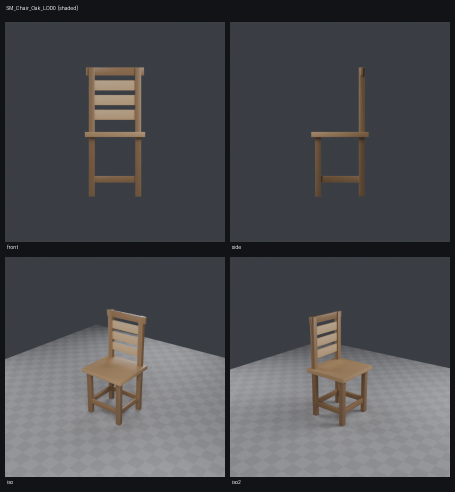

# Lathe

An agent-native 3D asset authoring system. The agent writes a program. The system returns a
verified asset.



## Why

Agents can already drive Blender through `bpy`. It mostly does not work, for structural
reasons rather than prompt-quality ones.

- **Hidden global state.** `bpy.ops` depends on mode, selection, active object and cursor —
  none of which appear in the call. A correct call becomes incorrect when preceded by another
  correct call.
- **Indices instead of names.** The job is "bevel the top rim". The API wants vertex 4,471.
- **No perception.** The script exits 0 and produces garbage. Nothing reports the inverted
  normals or the non-manifold edge.
- **No contract.** N-gons, unapplied scale, overlapping UVs, texel drift — every production
  failure mode is silent, so an agent ships all of them.

## Approach

- **Pure and deterministic.** Every operation is a function of its explicit arguments. Same
  program, same geometry, every time.
- **Selectors, not indices.** `carved.edges(dihedral > 60deg)` re-resolves on every
  evaluation, so an upstream edit does not invalidate a downstream reference.
- **Provenance that survives.** Tags ride Manifold's native ID channels. A bevelled solid put
  through a further boolean returns 0 unattributed triangles.
- **Cardinality assertions.** `assert count(rim) == 96` turns a silent selector mismatch into
  a loud error naming the assumption that broke.
- **Taste converted to assertions.** An agent cannot have judgement, but it can satisfy a
  spec. 14 rules across five profiles, each with a named code, the offending entity, numeric
  evidence, and an executable repair.
- **Perception as a subsystem.** Numeric probes first at 30–90 µs. Renders as contact sheets,
  never one flattering angle.

## What works today

| Asset | Tris | Verifier |
|---|---|---|
| `SM_Chair_Oak_LOD0` | 2,324 | PASS — 0 error, 0 warn, 0 note |
| `SM_BowlFruit_Ceramic_LOD0` | 5,848 | PASS — 0 error, 0 warn, 0 note |
| `SM_Villager_Stylized_LOD0` | 2,446 | PASS — 0 error, 0 warn, 0 note |

- Authoring kernel: primitives, booleans, revolve, extrude, arrays, transforms.
- Bevel through headless bmesh, with the non-inheriting tag default enforced in the wrapper.
- Verifier: E101–E108 plus W201, W202, W203, W206, W302, N401, across all five §7 profiles —
  `game_prop_pbr`, `character_skinned`, `mobile_vr`, `hard_surface_subdiv`, `film_usd`.
- **Rig rules, on any body plan.** E501–W505 grade an articulated asset: joint limits, reach
  targets, poses pinned against a bound, root count, and symmetry. Nothing among them knows
  what a body is — no rule counts limbs, assumes one root, bounds chain depth, or takes
  "symmetry" to mean bilateral. The plan is *declared* (radial with a fold, bilateral, or
  none) and checked on its own terms, so a five-armed starfish, a 24-link serpent and a
  six-legged arthropod are each gradeable and none is measured against a human.
- UV unwrapping via xatlas, packed to a declared texel density, so the UV rules run on real
  layouts rather than reporting *not checked*.
- High-to-low baking of normal and AO maps, with cage extrusion derived from the subject's own
  size and Flip Y switched by target engine. Moves a bevel out of geometry and into texture:
  the chair drops from 2,324 triangles to **308**, and its density spread from 418% off target
  to 17%.
- Perception: Tier 1 probes and Tier 2 structural summaries, both Blender-optional.
- Renderer: shaded contact sheets, silhouette mattes, wireframe overlays.
- Export: OBJ and STL written natively, glTF/FBX/USD/PLY through Blender, transform applied.
- **Import: `.glb` and `.gltf` read natively** — no Blender, no library. glTF is Y-up and
  splits a vertex at every seam, so a cube arrives with 24 vertices and every edge is a
  boundary; welding and the axis conversion are what decide whether an import can be
  booleaned at all. Draco and meshopt are refused by name rather than mis-decoded into
  plausible-looking rubbish.
- **The `.lathe` language**: `600mm` and `0.6m` unify, and `box(600, 600, 600)` fails to
  compile. Units are part of the type, so the metres-versus-millimetres bug cannot be written.
  It rigs, too — `joint`, `bind`, and §5.4's reserved `solve { reach head to (…) within 2mm }`.
  A joint limit is typed like everything else, so `limit (-90, 90)` is the same error
  `box(600, 600, 600)` is. A goal that does not converge raises rather than shrugging.
- **Articulation**: named joints with typed limits, forward kinematics, and a deterministic
  IK solver behind §5.4's `solve { }`. A pose is `{joint: angle}` — a parameter edit that
  diffs and writes back, never a mesh mutation. Rigid parts only; see
  [lathe/pose/](lathe/pose/README.md) for why that ceiling is where it is.
- **Interactive preview**: one self-contained HTML file — full orbit camera, adjustable
  lighting rig, four shading modes, and live vertex/polygon statistics with a per-tag
  breakdown. No library, no network, no Blender.
- **Posing in the preview, and it writes back.** Hand the viewer a `Rig` and it grows a
  slider per joint, bounded by that joint's declared limit, and articulates the model live.
  What it hands back is *text* — the pose as program source to paste in — which is §10's
  loop: "the app writes back a parameter or constraint edit, not an opaque mesh mutation …
  That feedback loop is the actual product." The page re-derives forward kinematics in
  JavaScript and checks itself against the kernel's own numbers on load, refusing to open
  rather than show a pose the kernel would disagree with.
- **Geometry parameters too, and the page is honest that it cannot preview them.** Pass
  `params` and each declared parameter gets a field; edits come back as
  `param seat_h = 480mm` in the unit the source wrote. Changing one needs Manifold and a
  re-evaluation, which a file with no network can never do — so the rows mark themselves
  pending and say why the model did not move. A control that silently failed to preview
  would read as broken and teach the reader to distrust the panel.
- **MCP surface: twelve tools**, so an agent can author, import, measure, look, validate,
  branch, compare and export without anyone writing Python. See
  [lathe/mcp/](lathe/mcp/README.md).
- `lathe_setup` audits the install and builds a **seeded welcome piece** — four styles,
  eight palettes, different for every user, handed back as editable program text.
- 590 tests. Checked against closed-form truth, not smoke. 561 pass without Blender
  installed; every one of the remaining 29 is gated on the bevel and needs Blender 5.2 on
  `PATH`.

## What is missing

Stated plainly, because the gap decides whether this is useful to you.

- **No LOD chain.** W204 and W205 need a chain and a silhouette comparison, and nothing
  generates one. Reduction would need decimation or retopology.
- **No component library**, so §9's `library()` tool is omitted rather than stubbed.
- **The DSL covers authoring, not everything.** `.lathe` has no loops and no user functions,
  so procedural work still goes through the Python escape hatch — where a bare `600` is once
  again a silent bug. `lathe_apply` takes either and picks by the first statement, so the
  typed path is reachable by an agent instead of being a library nobody calls. The two
  paths differ in safety too: the DSL interpreter is an AST walker with no builtins in scope,
  while the Python path runs `exec` in a restricted namespace that is explicitly not a
  sandbox.
- **No animation-grade topology, so articulation is rigid only.** Joints, FK and IK exist
  and parts move rigidly, which covers hinges, linkages and posable kit pieces. Skinning does
  not, and cannot yet: procedural geometry has no edge flow, the villager is a stylized figure
  rather than a riggable character, and [models/README.md](models/README.md) says so in
  detail. §12 defers quad remeshing and cage deformation, and that is still where deformation
  waits.
- **No keyframes.** A pose is a static parameter set. The IR has no time axis, and the
  verifier's asset model holds one mesh — which is also why W204 and W205 are unimplemented.

Topology is the one that still matters for the premise. The MCP surface exists now, so an
agent can drive this end to end.

## Quick start

Needs Python 3.12, `manifold3d`, `numpy`, `Pillow`, and Blender 5.2 for bevel and rendering.

```bash
pip install manifold3d numpy pillow
python models/build_all.py               # build, verify, probe and render all three
python models/build_all.py --no-render   # skip Blender, keep the checks
python -m pytest lathe/verify/tests -q   # 106 tests
python -m pytest lathe/perceive/tests -q # 172 tests
python -m pytest lathe/pose/tests -q     # 45 tests
```

Set `LATHE_BLENDER` if Blender is not on `PATH`.

## Repo map

| Path | Contents |
|---|---|
| [DESIGN.md](DESIGN.md) | The design, and every place a measurement corrected it |
| `lathe/build/` | Authoring kernel, selectors, assertions, bevel |
| `lathe/verify/` | Rule engine and profiles |
| `lathe/perceive/` | Numeric probes and structural summaries |
| `lathe/render/` | Contact sheets, mattes, wireframes |
| [`lathe/mcp/`](lathe/mcp/README.md) | The twelve-tool agent surface |
| `lathe/lang/` | The `.lathe` language: units, parser, evaluator |
| [`lathe/pose/`](lathe/pose/README.md) | Joints, forward kinematics, IK, rigid posing |
| `lathe/viewer/` | Self-contained interactive WebGL preview |
| [`lathe/io/`](lathe/io/README.md) | Export, and the native glTF reader |
| `models/` | The three test assets and the build runner |
| `prototype/` | Kernel spikes that settled the design questions |

## Status

Working prototype, not a product. `DESIGN.md` records the open questions, including the two
that could still move the design: whether the bevel choice survives curved input, and whether
one shared polygonal mesh type should replace the two that exist.
